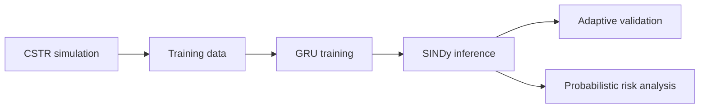

# RAISE Framework

**Real-Time Adaptive Artificial Intelligence System for Safety Enforcement**

Research implementation combining continuous stirred-tank reactor (CSTR) simulation, gated recurrent units (GRU), sparse identification of nonlinear dynamics (SINDy), and probabilistic process-risk analysis.

[](https://doi.org/10.1021/acs.iecr.6c00106)

## Publication

Rohan Thakur, Zaman Sajid, Md Tanjin Amin, Joseph Kwon, Faisal Khan. (2026). RAISE: Real-Time Adaptive Artificial Intelligence System for Safety Enforcement. *Industrial & Engineering Chemistry Research*, 65(18), 9519–9539. [10.1021/acs.iecr.6c00106](https://doi.org/10.1021/acs.iecr.6c00106).

[Publisher article](https://pubs.acs.org/doi/10.1021/acs.iecr.6c00106) | [DOI](https://doi.org/10.1021/acs.iecr.6c00106)

## Research workflow



## Repository structure

| Script | Purpose |
| --- | --- |
| [cstr_data.py](scripts/cstr_data.py) | Numerical simulation of CSTR dynamics |
| [train_gru.py](scripts/train_gru.py) | Multihorizon GRU training for SINDy coefficients |
| [gru_sindy_inference.py](scripts/gru_sindy_inference.py) | Trained model inference |
| [adaptive_validation.py](scripts/adaptive_validation.py) | Validation using GRU and Keras models |
| [raise_analysis.py](scripts/raise_analysis.py) | Fault probability, severity and risk analysis |

## Installation

```bash
git clone https://github.com/rohanst14/RAISE-Framework.git
cd RAISE-Framework
python -m venv .venv
# Activate the virtual environment for your operating system.
python -m pip install -r requirements.txt
```

## Reproducibility

Run scripts from the repository root. Start with `python scripts/cstr_data.py` to simulate reactor dynamics. Before training, inference or analysis, obtain the required datasets, checkpoints and fitted parameters listed in the [reproducibility guide](docs/reproducibility.md). The published scripts do not provide a complete end-to-end dataset-generation pipeline.

Dependencies are inferred from imports; versions and runtime compatibility are not yet validated. This research implementation is not a validated operational safety system.

## Citation

Please cite the associated paper and record the repository commit used. No software license is asserted.

## BibTeX

```bibtex
@article{Thakur2026RAISE,
  author = {Thakur, Rohan and Sajid, Zaman and Amin, Md Tanjin and Kwon, Joseph and Khan, Faisal},
  title = {{RAISE: Real-Time Adaptive Artificial Intelligence System for Safety Enforcement}},
  journal = {Industrial & Engineering Chemistry Research},
  year = {2026},
  volume = {65},
  number = {18},
  pages = {9519--9539},
  doi = {10.1021/acs.iecr.6c00106},
  url = {https://doi.org/10.1021/acs.iecr.6c00106}
}
```

Machine-readable citation: [CITATION.cff](CITATION.cff).
